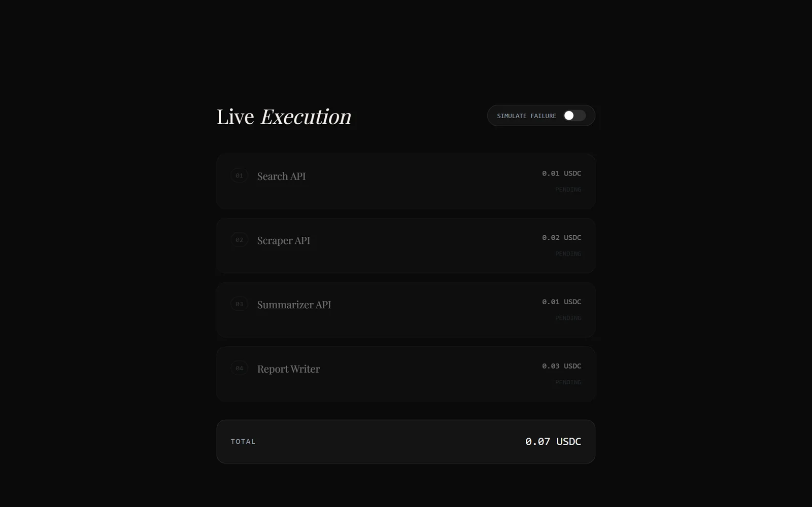

<div align="center">

# EMF Dashboard: Algorand AI Orchestration

**Pay once. Orchestrate everything.** One request coordinates several paid AI endpoints on Algorand, with each step settled as its own micro-payment.


</div>

## What it shows

An interactive demo of what [x402](https://x402.org)-style micro-payments could look like for multi-step AI workflows. A simulated research agent runs four steps. Each step is an independently priced API call, paid in USDC on Algorand testnet:

| Step | Service | Price |
|---|---|---|
| 01 | Search API | 0.01 USDC |
| 02 | Scraper API | 0.02 USDC |
| 03 | Summarizer API | 0.01 USDC |
| 04 | Report Writer | 0.03 USDC |

<table>
  <tr>
    <td width="50%"></td>
    <td width="50%"></td>
  </tr>
  <tr>
    <td><b>Start a workflow.</b> Type a research query or pick a preset (EV Market 2026, AI Trends, Competitor Analysis).</td>
    <td><b>Live execution.</b> Each step moves Pending → Paying → Settled with a simulated transaction hash. Total: 0.07 USDC.</td>
  </tr>
</table>

- **Atomic rollback**: switch on *Simulate failure* and a step fails mid-run. The earlier steps roll back and the total charge returns to 0.00 USDC, so settlement is all-or-nothing.
- **Unified receipt**: once the run completes, every micro-settlement is combined into one itemised receipt with a master hash.
- **Cost breakdown**: a per-step chart of what was paid for.

All payments in this demo are simulated; no wallet or testnet transaction is involved.

## Why Algorand

Fast finality and low fees make per-request payments practical. Instead of a subscription or one bulk payment, each API call in a multi-step workflow can settle on its own.

## Tech stack

Next.js 16 (App Router), React 19, TypeScript, Tailwind CSS 4, Framer Motion, Recharts, Lucide icons.

## Run locally

```bash
npm install
npm run dev        # http://localhost:3000
npm run build      # production build
npm run lint
```

## Project structure

```
src/
  app/
    layout.tsx
    page.tsx                    the dashboard page
  components/
    Hero.tsx                    landing hero
    WorkflowInput.tsx           research query input and presets
    LiveWorkflowExecution.tsx   step-by-step payment simulation
    UnifiedReceipt.tsx          combined settlement receipt
    CostBreakdown.tsx           per-step cost chart
```
